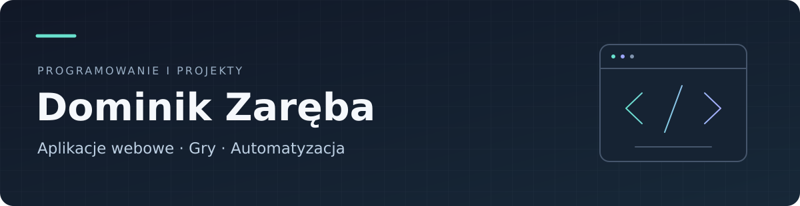

Cześć, jestem **Dominik** — absolwent informatyki na **UMCS w Lublinie**. Tworzę aplikacje webowe, strony internetowe i gry. Zajmuję się również automatyzacją, analizą danych i dokumentacją techniczną.

Lubię projekty, w których można połączyć kod z konkretnym efektem: działającą aplikacją, mechaniką gry albo narzędziem, które upraszcza codzienną pracę.

## Wybrane projekty

| Projekt | Co pokazuje | Technologie |
| --- | --- | --- |
| **[KnowYourPill](https://github.com/Vexusssek/KnowYourPill)** | Prototyp asystenta informacji o lekach: aplikacja webowa, wyszukiwanie w bazie wiedzy i integracja z modelami językowymi. | FastAPI · Streamlit · RAG · Docker |
| **[Old Tower](https://github.com/Vexusssek/Roguelike-from-Scratches-Old-Tower)** | Konsolowy roguelike napisany od podstaw: generowanie pomieszczeń, walka, rozwój postaci i ekwipunek. | C++17 · CMake · Windows / Linux |
| **[The Croupier](https://github.com/Vexusssek/the-croupier)** | Zespołowy projekt gry. Mój wkład: level design, historia, mechaniki, implementacja i muzyka. **Work in progress.** | Godot · GDScript · Game design |
| **[Analiza EEG](https://github.com/Vexusssek/projekt-lic)** | Praca licencjacka: analiza sygnałów, własna ekstrakcja cech, porównanie modeli i interfejs webowy z raportami. | Uczenie maszynowe · Streamlit · Przetwarzanie sygnałów |

## W czym mogę pomóc

- **Aplikacje i strony:** backend, integracje, rozwój istniejących rozwiązań, WordPress.
- **Gry:** prototypy, mechaniki, interakcje, dialogi, projektowanie poziomów i muzyka.
- **Automatyzacja i dane:** skrypty, porządkowanie i przetwarzanie danych, raporty, Excel.
- **Zaplecze techniczne:** Linux, środowiska wirtualne, testowanie, poprawki i dokumentacja.

**Języki:** C · C++ · Java · JavaScript · GDScript · Python · Bash · SQL

**Narzędzia i środowiska:** Git · Godot · Spring Boot · FastAPI · Docker · Linux · WordPress

## Więcej mojego kodu

[**MiniGamesFIFO**](https://github.com/Vexusssek/ProjektMiniGamesFIFO) — trzy gry dla dwóch terminali, napisane w C z komunikacją przez potoki nazwane FIFO.

Chcesz omówić aplikację, stronę, prototyp gry lub automatyzację? Opisy projektów, demonstracje i zakres mojej pracy znajdziesz w repozytoriach powyżej.
